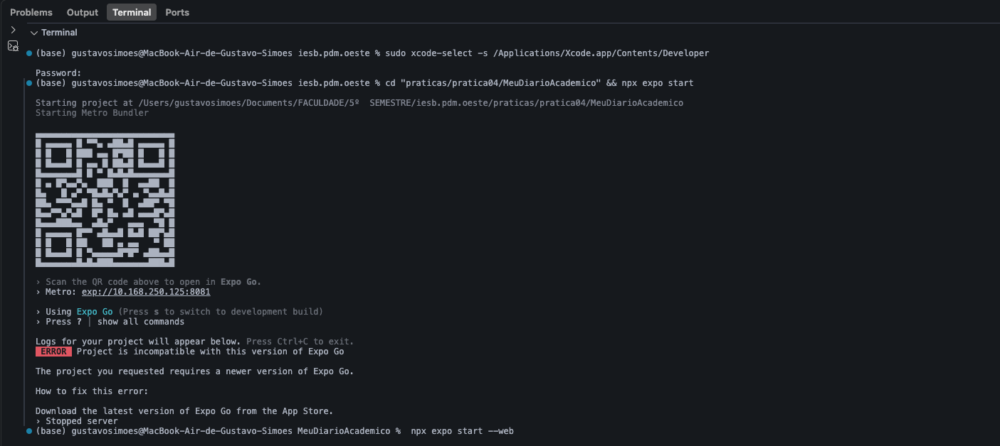
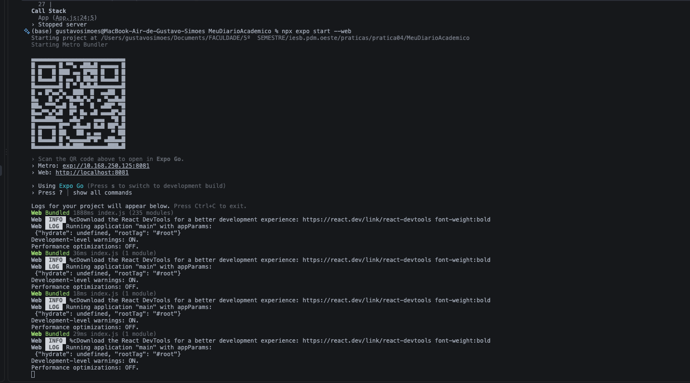
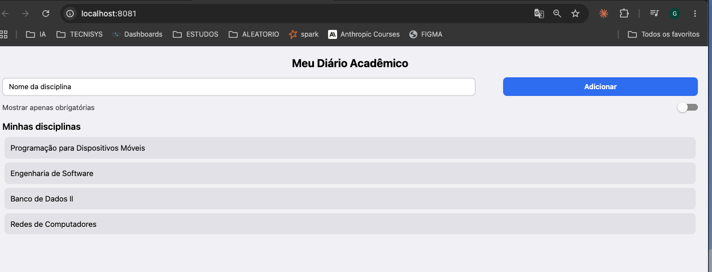

# Meu Diário Acadêmico — Prática 04

App Expo (React Native) com uma tela de cadastro rápido de disciplinas do semestre: campo de texto, botão para adicionar, lista das disciplinas cadastradas e um switch para filtrar só as obrigatórias.

## O que foi implementado

- `labels.js` com as constantes de texto (título, placeholder, botão, título da lista), importadas no `App.js`.
- `SafeAreaView`/`SafeAreaProvider` (de `react-native-safe-area-context`) envolvendo a tela.
- Linha com `TextInput` (~70% de largura) e botão `Adicionar` (~28%), feito com `Pressable` e estilo de pressionado.
- Lista de disciplinas com estado (`useState`): digitar um nome e apertar "Adicionar" inclui a disciplina na lista.
- `Switch` "Mostrar apenas obrigatórias" que filtra a lista de verdade.
- Estilos em `StyleSheet.create`, usando `flex` e largura em `%` (sem dimensões fixas em pixel).

## Comando usado para criar o projeto

```bash
npx create-expo-app@latest MeuDiarioAcademico --template blank
```

## Bibliotecas adicionais

```bash
npx expo install react-native-safe-area-context
npx expo install react-dom react-native-web
```

## Como rodar

```bash
cd MeuDiarioAcademico
npm install
npx expo start
```

Escaneie o QR code com o Expo Go, ou rode `npx expo start --web` para abrir no navegador.

## Prints






