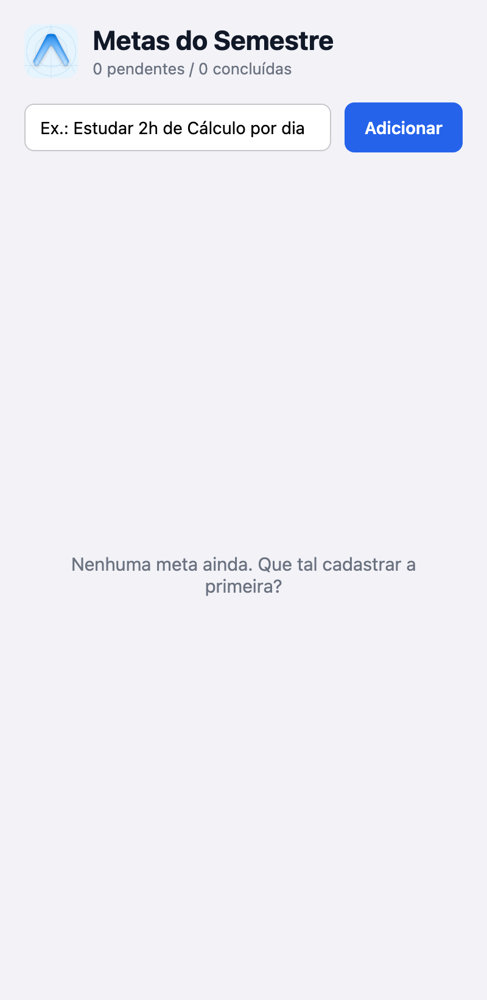
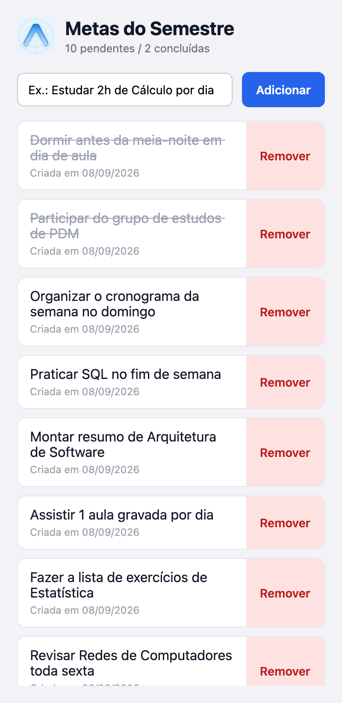
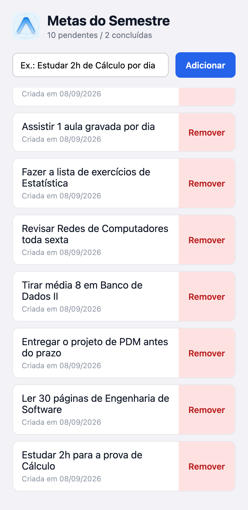

# Metas do Semestre — Prática 05

App Expo (React Native) para cadastrar **metas de estudo do semestre**. O aluno
digita a meta, adiciona à lista, pode marcar como concluída ou remover, e os
dados **sobrevivem ao fechar o app** graças ao AsyncStorage.

## O que foi implementado

### A) Estado e lista (`useState`)
- `texto` → conteúdo do `TextInput`.
- `metas` → array de metas. Cada meta é um objeto:
  `{ id, texto, criadaEm, concluida }`.
- `id` único gerado com `Date.now().toString()`.
- `carregou` → flag que indica se a carga inicial já terminou (evita o bug de
  salvar `[]` por cima dos dados antes do `loadTasks` rodar).

### B) Componentização (`components/`)
- **[`MetaInput.js`](MetasSemestre/components/MetaInput.js)** — `TextInput` +
  `Pressable` "Adicionar". Props: `value`, `onChangeText`, `onAdd`. Não guarda
  estado próprio.
- **[`MetaList.js`](MetasSemestre/components/MetaList.js)** — `FlatList` das
  metas. Props: `metas`, `onDelete`, `onToggle`. Também sem estado próprio.
- **[`constants.js`](MetasSemestre/constants.js)** — chave do AsyncStorage
  (`@metas_semestre`) e textos da interface centralizados.

### C) Eventos
- **Adicionar**: `texto.trim()`; se vazio, `Alert.alert('Meta vazia', ...)` e
  não adiciona. Caso contrário cria um **novo array** com
  `setMetas((atuais) => [nova, ...atuais])` (nunca `push`/`splice`).
- **Remover**: `Pressable` "Remover" →
  `setMetas((atuais) => atuais.filter((meta) => meta.id !== id))` (filter por
  `id`, não por índice).
- **Concluir** (desafio): toca no texto da meta →
  `map` trocando só a meta do `id` por `{ ...meta, concluida: !meta.concluida }`,
  com estilo `textDecorationLine: 'line-through'`.
- **Feedback visual**: `android_ripple` nos botões Adicionar / Remover / no card,
  e `style={({ pressed }) => [...]}` nos `Pressable`.

### D) Persistência (AsyncStorage + `useEffect`)
Os dois `useEffect` estão em
**[`App.js`](MetasSemestre/App.js)**:

| Efeito | Onde | Deps | O que faz |
|---|---|---|---|
| **Carga** | `App.js` — 1º `useEffect` (`carregarMetas`) | `[]` (só na montagem) | `AsyncStorage.getItem('@metas_semestre')` → `JSON.parse` → `setMetas`. No `finally` marca `setCarregou(true)`. |
| **Salvamento** | `App.js` — 2º `useEffect` (`salvarMetas`) | `[metas, carregou]` | Sempre que `metas` muda (add / delete / toggle) grava com `AsyncStorage.setItem('@metas_semestre', JSON.stringify(metas))`. O `if (!carregou) return;` impede sobrescrever o storage antes da carga terminar. |

Os dois usam `try/catch` e, em caso de erro, mostram um `Alert` amigável
("Não foi possível carregar/salvar suas metas").

### E) UI
- `SafeAreaProvider` + `SafeAreaView` (de `react-native-safe-area-context`).
- Cabeçalho com `Image` local (`./assets/icon.png`) + título **"Metas do
  Semestre"** e o contador **"X pendentes / Y concluídas"** (desafio).
- Lista rolável com **`FlatList`** (`data` / `keyExtractor` / `renderItem` /
  `ListEmptyComponent`).

## Comando usado para criar o projeto

```bash
npx create-expo-app@latest MetasSemestre --template blank
```

## Bibliotecas adicionais

```bash
npx expo install @react-native-async-storage/async-storage react-native-safe-area-context
npx expo install react-dom react-native-web   # só para rodar/testar no navegador
```

## Como rodar

```bash
cd praticas/pratica05/MetasSemestre
npm install
npx expo start
```

Abra no Expo Go (QR code) ou rode `npx expo start --web`.

## Prints

**Lista vazia** (`ListEmptyComponent`):



**Com itens** — 12 metas, 2 marcadas como concluídas (texto riscado) e o
contador do cabeçalho em "10 pendentes / 2 concluídas":


**Depois de reabrir o app** — o app foi recarregado do zero e as 12 metas
(incluindo as 2 concluídas) voltaram do AsyncStorage:



Rolando a `FlatList` até o fim, todas as metas antigas continuam lá:



> Os prints foram gerados rodando o app no `expo start --web` (o AsyncStorage no
> navegador usa `localStorage`, então "reabrir" = recarregar a página).

## Onde está cada `useEffect` (resumo pedido na entrega)

- **`useEffect` de CARGA**: `MetasSemestre/App.js`, primeiro `useEffect`, função
  `carregarMetas`, array de dependências `[]` — roda uma única vez quando o app
  monta e popula o estado com o que estiver salvo.
- **`useEffect` de SALVAMENTO**: `MetasSemestre/App.js`, segundo `useEffect`,
  função `salvarMetas`, dependências `[metas, carregou]` — roda a cada mudança
  da lista e regrava tudo no AsyncStorage.
