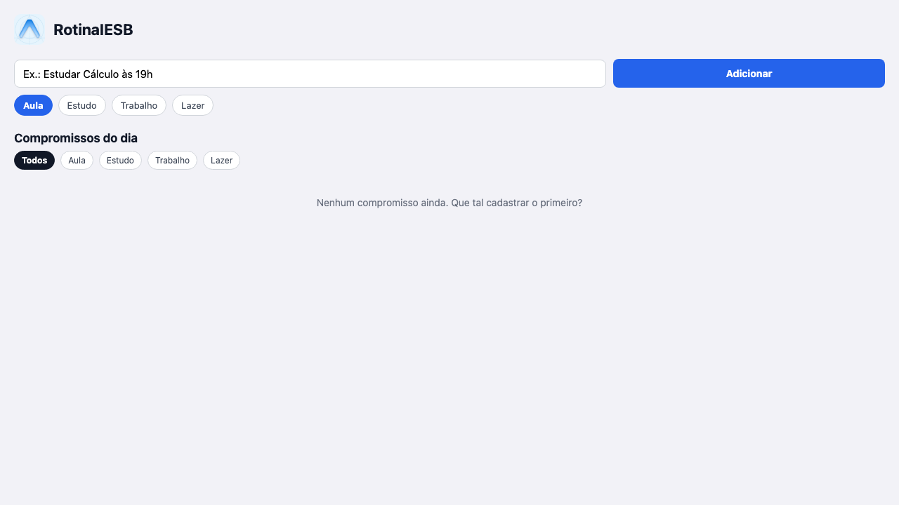
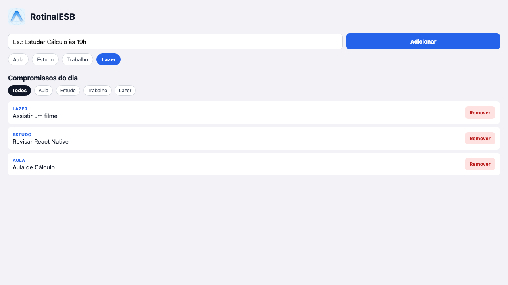
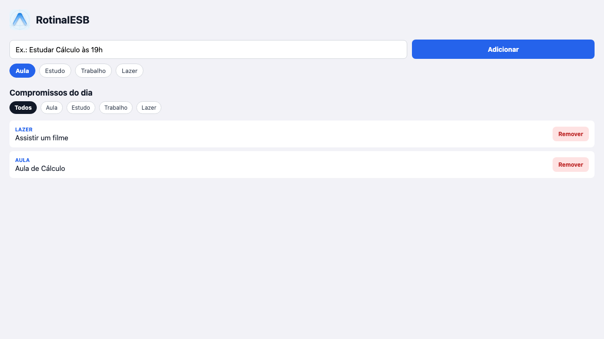

# RotinaIESB — Atividade Integradora

App Expo (React Native) que funciona como organizador da rotina acadêmica do
aluno no IESB: cadastro de compromissos do dia (aula, estudo, trabalho ou
lazer), visualização em lista com filtro por categoria, remoção e
persistência com AsyncStorage.

Consolida os conteúdos das Aulas 02 a 06: estrutura de projeto Expo,
import/export, Core Components + StyleSheet, Flexbox, `useState` +
componentização + props, e eventos + `useEffect` + AsyncStorage.

## Comando usado para criar o projeto

```bash
npx create-expo-app@latest RotinaIESB --template blank
npx expo install @react-native-async-storage/async-storage react-native-safe-area-context
```

## Como rodar

```bash
cd praticas/pratica06/RotinaIESB
npm install
npx expo start
```

Abra no Expo Go (QR code) ou rode `npx expo start --web`.

## Estrutura

```text
RotinaIESB/
  App.js
  labels.js
  assets/logo.png
  components/
    CompromissoInput.js
    CompromissoList.js
  package.json
  app.json
```

- **[`labels.js`](labels.js)** — todos os rótulos da interface como
  `export const` nomeados (`tituloApp`, `placeholderCompromisso`,
  `botaoAdicionar`, `tituloLista`, `listaVazia`, etc.), a chave do
  AsyncStorage (`STORAGE_KEY`) e a lista de categorias (`CATEGORIAS`).
- **[`components/CompromissoInput.js`](components/CompromissoInput.js)** —
  `TextInput` (~68% de largura) + `Pressable` "Adicionar" (`flex: 1`) +
  chips de categoria. Props: `value`, `onChangeText`, `categoria`,
  `onChangeCategoria`, `onAdd`, `labels`. Sem estado próprio.
- **[`components/CompromissoList.js`](components/CompromissoList.js)** —
  chips de filtro por categoria + `FlatList` com `ListEmptyComponent`. Props:
  `itens`, `onDelete`, `tituloLista`, `listaVazia`, `filtroAtivo`,
  `onChangeFiltro`. Sem estado próprio.

## Onde estão os `useEffect` (carga e salvamento)

Ambos em **[`App.js`](App.js)**:

| Efeito | Função | Deps | O que faz |
|---|---|---|---|
| **Carga** | `carregarCompromissos` (1º `useEffect`) | `[]` (só na montagem) | `AsyncStorage.getItem('@rotina_iesb_compromissos')` → `JSON.parse` → `setCompromissos`. No `finally` marca `setCarregou(true)`. |
| **Salvamento** | `salvarCompromissos` (2º `useEffect`) | `[compromissos, carregou]` | Sempre que a lista muda (adicionar/remover), grava com `AsyncStorage.setItem(STORAGE_KEY, JSON.stringify(compromissos))`. O `if (!carregou) return;` evita sobrescrever o storage com `[]` antes da carga terminar. |

Os dois usam `try/catch` e mostram um `Alert.alert` amigável em caso de erro
(`erroCarregar` / `erroSalvar` em `labels.js`).

## Requisitos implementados

- Cada compromisso é `{ id, texto, categoria, criadoEm }`, com
  `id: Date.now().toString()`.
- Adicionar valida texto vazio com `Alert.alert` (não permite compromisso em
  branco).
- Remover usa `Pressable` + `.filter` por `id` (nunca por índice).
- `FlatList` com `keyExtractor={(item) => item.id}` e `android_ripple` nos
  botões e chips.
- `SafeAreaProvider` + `SafeAreaView` de `react-native-safe-area-context`.
- Layout: cabeçalho em `row` (logo + título), formulário em `row`
  (input com `width: '68%'` + botão com `flex: 1`), lista com `flex: 1`.

## Desafios opcionais implementados (2)

- **O1 — Categoria + filtro**: cada compromisso tem uma `categoria`
  (aula/estudo/trabalho/lazer) escolhida por chips no formulário, e a lista
  tem chips de filtro ("Todos" + as 4 categorias) que filtram os itens
  exibidos sem afetar o que está salvo.
- **O4 — FlatList + ListEmptyComponent**: a lista usa `FlatList` (não
  `ScrollView`/`.map`) com `ListEmptyComponent` mostrando o texto de
  `listaVazia` quando não há compromissos (ou quando o filtro não encontra
  nenhum).

## Prints

Gerados rodando o app com `npx expo start --web` (no navegador o
AsyncStorage usa `localStorage`, então "reabrir" = recarregar a página).

**Lista vazia** (`ListEmptyComponent`):



**Com itens** — 3 compromissos em categorias diferentes (Lazer, Estudo,
Aula), filtro "Todos" ativo:



**Depois de reabrir o app** — a página foi recarregada e os 2 compromissos
restantes (após remover "Revisar React Native") continuam lá, vindos do
AsyncStorage:


